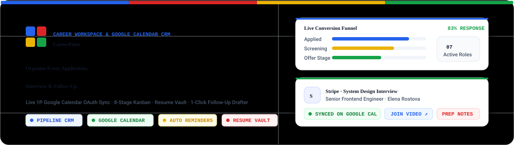
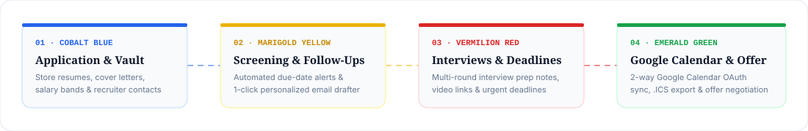
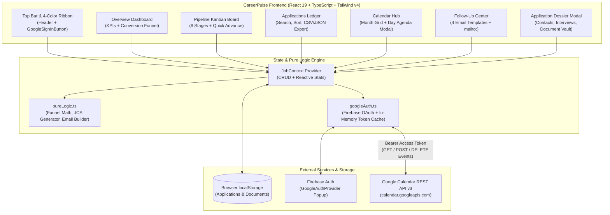
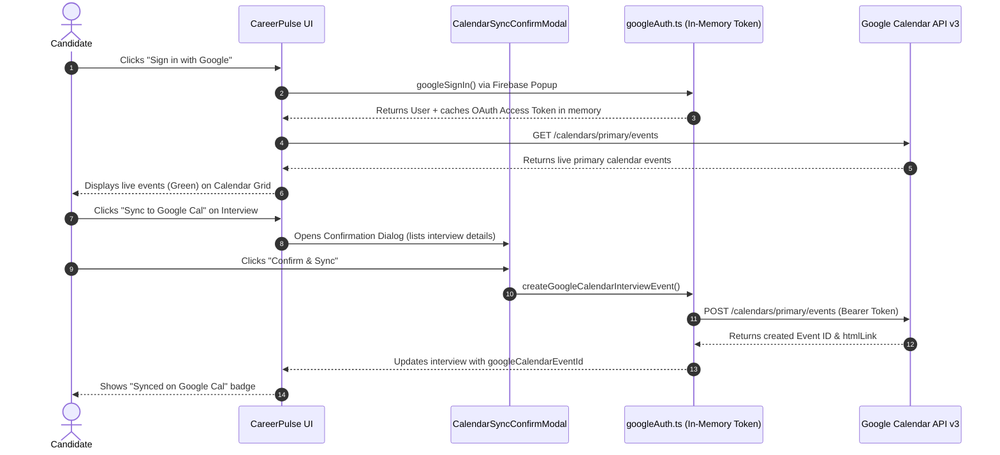

<div align="center">



<br />

# CareerPulse — Job Application & Google Calendar CRM

**An editorial, architectural workspace to organize job applications, visualize pipeline velocity, sync interviews with Google Calendar, automate follow-up emails, and manage tailored resumes & cover letters.**

[](https://react.dev/)
[](https://www.typescriptlang.org/)
[](https://developers.google.com/calendar)
[](https://tailwindcss.com/)
[](#testing--verification)

</div>

---

## ✨ Visual Workflow & Lifecycle

<div align="center">
  
</div>

---

## 🎨 Architectural Color System (White · Red · Blue · Green · Yellow)

CareerPulse is designed around a high-craft **Swiss / Google Atelier** palette combining a **60% Crisp Alabaster White** canvas with four semantic primary accents:

| Swatch | Color Name | Hex Code | Semantic Role in CareerPulse |
| :---: | :--- | :--- | :--- |
| ⬜ | **Alabaster White** | `#FFFFFF` / `#F8FAFC` | Primary workspace canvas, elevated dossier cards, and high-contrast reading surfaces |
| 🟦 | **Cobalt Blue** | `#2563EB` / `#1D4ED8` | Primary interactive CTAs, **Applied** & **Technical** stages, active navigation indicators, and video call links |
| 🟥 | **Vermilion Red** | `#DC2626` / `#B91C1C` | **Overdue follow-up alerts**, urgent application deadlines, and **Final Interview** stage indicators |
| 🟨 | **Marigold Yellow** | `#EAB308` / `#CA8A04` | **Screening** stage, **Due Today** follow-up reminders, high-priority badges, and response rate benchmarks |
| 🟩 | **Emerald Green** | `#16A34A` / `#15803D` | **Live Google Calendar Sync** status, **Offers Received**, and completed interview rounds |

### Typography Pairing
- **Display & Editorial Headlines**: `Fraunces` (Variable Optical-Size Serif) for company titles, section headers, and KPI numerals.
- **UI & Operational Controls**: `Plus Jakarta Sans` for crisp scannability across dense tables, filters, and forms.
- **Tabular Data & Timestamps**: `JetBrains Mono` (`tabular-nums`) for salary bands, interview dates, and conversion metrics.

---

## 🚀 Core Capabilities

### 1. 📊 Executive Dashboard & Conversion Funnel
- **Real-Time KPI Strip**: Tracks *Total Roles*, *Active In Flight*, *Response Rate* (with industry benchmark comparison), *Interview Yield*, *Scheduled Rounds*, and *Offers Received*.
- **Stage Progression Funnel**: Visualizes candidate conversion velocity across `Applied` → `Screening` → `Technical` → `Interview` → `Offer`.
- **Priority Queue Banner**: Automatically surfaces overdue follow-ups, today's check-ins, and upcoming interviews within 48 hours.

### 2. 📅 Live 1P Google Calendar OAuth Integration
- **Official Google Sign-In**: Uses Firebase Authentication (`GoogleAuthProvider`) with in-memory OAuth 2.0 access token caching.
- **Two-Way Calendar Visibility**: Fetches live events from the user's primary Google Calendar (`GET /calendar/v3/calendars/primary/events`) and renders them alongside tracked job interviews in the monthly grid.
- **1-Click Event Creation & Bulk Sync**: Push individual interview rounds or bulk-sync all upcoming interviews directly to Google Calendar (`POST /calendar/v3/calendars/primary/events`), complete with video meeting links, interviewer names, and preparation notes.
- **Safety Confirmation Dialogs**: Every mutating or destructive calendar operation (`Sync Event`, `Sync All`, `Unsync / Delete Event`) is gated by an explicit confirmation modal detailing the affected calendar items.
- **Universal `.ICS` Export**: RFC 5545-compliant iCalendar export for Apple Calendar, Outlook, or offline backup.

### 3. 🗂️ Kanban Pipeline & High-Density Ledger
- **8-Stage Kanban Board**: Move applications across `Wishlist`, `Applied`, `Screening`, `Technical`, `Interviewing`, `Offer Received`, and `Archived` with 1-click stage shifters.
- **Bespoke Company Monograms (`CompanyBadge`)**: Brand-tinted typographic emblems for every company.
- **Sortable & Exportable Ledger Table**: Filter by stage, work mode (`Remote`, `Hybrid`, `On-site`), or priority, and export your entire ledger to **CSV** or **JSON**.

### 4. ✉️ Automated Follow-Up Center & Letter Drafter
- **Smart Follow-Up Queue**: Categorizes check-ins into *Overdue* (Red), *Due Today* (Yellow), and *Upcoming* (Green) with 1-click rescheduling.
- **4 Context-Aware Email Templates**:
  1. *Post-Application Check-In*
  2. *Post-Interview Thank You Note*
  3. *Timeline & Status Inquiry*
  4. *Offer Appreciation & Negotiation*
- **Instant `mailto:` Launch & Clipboard Copy**: Pre-fills recruiter email addresses, subject lines, and personalized candidate signatures.

### 5. 📄 Document Vault (Resumes & Cover Letters)
- **Per-Application File Attachments**: Upload tailored resumes, cover letters, portfolios, and offer letters (`.pdf`, `.txt`, `.md`, `.docx`) directly to each job dossier.
- **In-Browser Document Reader**: Preview plain-text/Markdown cover letters and PDF metadata in-app or download original files with one click.

---

## 🏗️ System Architecture & Data Flow



---

## 🔐 Google Calendar OAuth Sequence



---

## 📂 Project Structure

```text
├── firebase-applet-config.json       # Provisioned Firebase & Google OAuth configuration
├── index.html                        # Entry HTML with Fraunces, Plus Jakarta Sans & JetBrains Mono
├── public/
│   └── assets/
│       ├── careerpulse-banner.svg    # Animated SVG hero banner for documentation
│       └── pipeline-flow.svg         # Animated SVG 4-color workflow diagram
└── src/
    ├── App.tsx                       # Root layout with 4-color architectural ribbon & global modals
    ├── index.css                     # Tailwind CSS v4 configuration & custom scrollbars
    ├── types/
    │   └── job.ts                    # TypeScript interfaces for Applications, Interviews & Documents
    ├── data/
    │   └── initialApplications.ts    # Realistic seed data (Stripe, Airbnb, Linear, Vercel, Anthropic, Figma, Meta)
    ├── utils/
    │   ├── pureLogic.ts              # Pure functions: stats, date math, RFC 5545 .ICS, email generator
    │   ├── pureLogic.test.ts         # Node built-in unit test suite (5/5 passing)
    │   └── googleAuth.ts             # Firebase Google OAuth + Google Calendar v3 REST client
    ├── context/
    │   └── JobContext.tsx            # Global state provider, localStorage sync & Calendar actions
    └── components/
        ├── Header.tsx                # 3-zone navigation header with 4-quadrant emblem
        ├── NotificationBanner.tsx    # Priority queue for overdue follow-ups & next interview
        ├── GoogleSignInButton.tsx    # Official Google Sign-In button & connected status bar
        ├── CalendarSyncConfirmModal.tsx # Safety confirmation modal for Google Calendar mutations
        ├── CompanyBadge.tsx          # Brand-authentic typographic company monograms
        ├── DashboardView.tsx         # KPI cards, conversion funnel, interviews & deadlines
        ├── ApplicationsKanban.tsx    # 8-column pipeline board with stage shifters
        ├── ApplicationsTable.tsx     # Sortable ledger with CSV & JSON backup export
        ├── CalendarView.tsx          # Monthly calendar merging interviews, deadlines & Google Calendar
        ├── FollowUpCenter.tsx        # Follow-up queue & 4-template email drafter
        ├── ApplicationDetailModal.tsx# Full candidate dossier (Overview, Interviews, Documents, Timeline)
        ├── ApplicationFormModal.tsx  # Add / Edit application & recruiter contact modal
        ├── EmailComposerModal.tsx    # Quick follow-up email popup
        └── DocumentPreviewModal.tsx  # In-browser resume & cover letter previewer
```

---

## 🧪 Testing & Verification

Core business logic (date comparisons, dashboard conversion funnel math, Google Calendar URL formatting, RFC 5545 `.ics` file generation, and template email drafting) is decoupled in `src/utils/pureLogic.ts` and verified via Node's built-in test runner:

```bash
# Run the unit test suite
npx --yes tsx --test src/utils/pureLogic.test.ts

# Type-check the entire application
npm run lint

# Build for production
npm run build
```
